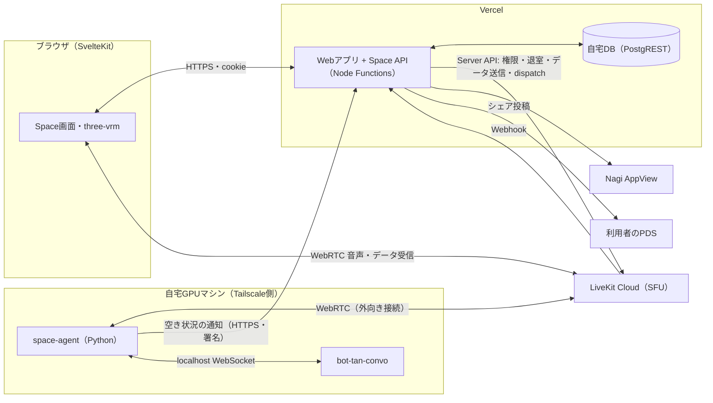

# Design

## Context

目的と範囲は proposal.md、振る舞いは各 spec.md を参照する。設計を左右する現状の制約は次のとおり。

- **bot-tan-convo** は自宅のGPUマシンで動き、Tailscaleの内側からしか呼べない（`Tailscale-User-Login` ヘッダで認証）。API v1は1セッション＝1人との会話が前提で、上り音声は話者を区別しない。セッション数は設定値（`max_sessions`、現状2〜3）。ASRはプロセス内で共有し、ロックで1件ずつ処理する。ASRの処理時間は、2026-11-20のメモでspeech.cpp（CPU）が1発話約125ms、Whisper（GPU）が約157ms。それ以外は計測されていない。
- **Nagi** はVercel上のSvelteKitアプリ。AT Protocol OAuthはブラウザ側の公開クライアントで行う。デフォルトテーマは `bot-mint` で、表示は `system / light / dark` から選ぶ。
- **nagi-passport** はNagi AppViewが署名する60秒有効・1回限りのチケットで、「この利用者はdid:plc:xxxである」ことだけを運ぶ。アクセストークンは含まないため、PDSへの書き込み（Nagiへのシェア）には本アプリ自身のOAuth認可が別に要る。消費側は1回限りの記録（`TicketStore`）を不可分に実装する必要がある。
- **LiveKit Cloud 無料枠**：参加者の接続時間 月5,000分、同時接続100、下り50GB。超えると新しい接続を受け付けない（従量課金は無い）。サーバー側の参加者（botたん・字幕用）も接続時間に数える。
- 姉妹アプリの bot-tan-room は、botたんのVRMをすでに公開配信している。

## Goals / Non-Goals

**Goals:**

- convoをインターネットに公開せずに、botたんをSpaceへ参加させる。
- 権限（発話・ミュート・退室・リアクション）をすべてサーバー側で強制し、クライアントの改変で迂回できないようにする。
- LiveKit Cloudからセルフホストへ、接続先URLと鍵の差し替えだけで移れるようにする。
- 音声・字幕・リアクションを、どこにも保存しない経路だけで流す。

**Non-Goals:**

- convoの会話品質（人物設定・LLM）の改善。複数話者への対応に必要な改修に限る。
- ARDYによる、その場で生成する体の動き（作り置きの動きだけを使う。後述）。
- 他のNagi配色テーマへの対応。

## 全体構成



## Decisions

### D1. Webアプリとサーバーは Vercel（Node）上の SvelteKit、保存は自宅DB（PostgREST）

Nagiと同じSvelteKit・Tailwindにして、テーマ・絵文字ピッカーなどの部品とノウハウを流用する。Space APIは同じアプリのサーバールート（Node Functions）に置く。リアルタイムの通信はLiveKitが担うので、サーバーに常時接続は要らない。

状態の保存は、自宅のPostgreSQLを **PostgREST**（db.suibari.com、Cloudflare Tunnel と Cloudflare Access のサービストークンで保護）経由で使う。専用スキーマ `nagi_space` に、期限付きのキー・値の表と、それを操作する関数（取得・期限付きの書き込み・「無ければ書く」・値が一致するときだけ消す・接頭辞での一覧）だけを置き、表そのものはPostgRESTに公開しない。アプリは「キー・値ストア」のインターフェースだけに依存する。ローカルではDockerのPostgreSQLとPostgRESTで同じ構成を動かす。

- 採用理由（2026-11-26 利用者と決定）：Nagi AppViewも自宅にあり、自宅が止まればNagi Spaceも止まってよい。外部サービスの無料枠（Upstashは月50万コマンド）と従量課金を気にせずに済む。
- 期限切れの行は、書き込みのたびにまれに掃除する（pg_cron に依存しない）。読み取りは期限切れの行を無視するので、掃除の遅れは結果に影響しない。
- 1回の画面表示の往復を減らすため、セッションの読み取りと期限の延長を1回の関数呼び出しにまとめ、OAuthセッションと登録の確認は複数キーの取得1回で読む。
- 代替案：Upstash Redis（最初の案）。速くTTLも使えるが、無料枠が実利用に足りない。自宅でRedisを動かす案は、Cloudflare Tunnel越しのTCP接続をVercelから使えないため採らない。

### D2. 認証はサーバー側OAuth（confidential client）とcookieセッション

権限をサーバーで強制するには、サーバーが利用者のDIDを確実に知る必要がある。ブラウザのOAuthトークンはDPoP鍵に束縛されていて、サーバーへ渡して検証させることができない。そこで `@atproto/oauth-client-node` で本アプリ自身がOAuthクライアントになり、HttpOnlyのcookieでセッションを持つ。

- **全員がOAuth認可を通る**：AppViewの認証付きAPI（ミュート一覧・通報・設定）は本人のPDS経由でしか呼べない（「外部契約の調査結果」）。そのため、チケットだけのセッションは作らない。
- **Nagiからの移動**：nagi-passportのチケットを検証してDIDを確かめ、そのDIDをOAuthの `login_hint` にしてハンドルの入力を省く（ACC-01）。チケットはDIDの特定にだけ使い、セッションの根拠にはしない。
- **スコープ**：ログイン時にまとめて要求する。`atproto`、`rpc:com.suibari.nagi.getMutes?aud=*`、`rpc:com.suibari.nagi.getPreferences?aud=*`、`rpc:com.suibari.nagi.createReport?aud=*`、`rpc:com.suibari.nagi.ensureRecord?aud=*`、`repo:com.suibari.nagi.post?action=create`、`blob:image/*`。シェアのために後から認可し直す導線は作らない。
- **Nagi登録状態と本人のミュート一覧**はサーバーからAppViewに問い合わせる（ACC-02、PART-09）。ミュート一覧は本人だけの情報なので、本人へのレスポンスと本人の一覧の絞り込みにだけ使い、他の参加者やホストには渡さない。結果は短時間キャッシュする。年齢による制限はしないので（ACC-05）、年齢は問い合わせない。

### D3. Space＝LiveKitのroom。ロールはトークンの権限で強制する

Spaceごとに1つのroomを作る。入室時にSpace APIがLiveKitのアクセストークンを発行し、そこに次の権限を入れる。

| ロール | canPublish | canSubscribe | canPublishData |
|---|---|---|---|
| ホスト・スピーカー | マイクのみ | ○ | × |
| 聴衆 | × | ○ | × |
| space-agent（字幕・botたん） | 音声（botたんのみ） | ○ | ○ |

ロールの変更（承認・取り消し）はServer APIの `UpdateParticipant` で権限を変える。ミュートは `MutePublishedTrack`、退室は `RemoveParticipant` で行い、再入室の禁止は自宅DBに記録して、トークンの発行時に確認する（PART-06）。ブラウザは `canPublishData` を持たないので、偽の字幕やリアクションを流せない。

参加者の出入りはLiveKitのWebhookで受け、一覧の人数（LIFE-03）、ホストの切断（LIFE-06）、1対1の判定（PART-05）に使う。

### D4. リアクションはSpace API経由で送る

連投制限をサーバーで行う必要があるので（REACT-03）、ブラウザはリアクションをSpace APIへPOSTする。APIはSpace・ユーザー単位の制限を自宅DBで数え、通ったものだけをLiveKitの `SendData` でroomへ配る。保存はしない（REACT-04）。ミュートしている人の絵文字を隠す処理（PART-09）は、受け取ったブラウザが本人のミュート一覧で行う。サーバーで宛先を絞ると、送り主ごとに配信先が変わる経路ができてしまうためである。カスタム絵文字は、AppViewで存在し規格に合うものだけを受け付ける。

### D5. botたんと字幕は自宅の space-agent が担う

convoを公開しないために、自宅マシンで **space-agent**（Python、LiveKit Python SDK。このリポジトリの `agent/`）を動かす。space-agentは外へ向かう通信（LiveKit と Nagi Space）だけを使い、自宅側でポートを開ける必要は無い。

- **同期**：space-agent は数秒ごとに `POST /agent/sync`（共有の秘密 `AGENT_SECRET`）を呼び、convo の空き（botたんの会話・字幕のつなぎ）を知らせて、開催中の Space の一覧（字幕と botたんの参加者のトークン付き）を受け取る。LiveKit の agent dispatch は使わない（LiveKit Cloud でもセルフホストでも同じに動き、自宅から外への通信だけで済むため。2026-11-27 に変更）。
- **字幕用の参加者**（`agent:captions`、見えない参加者）：開催中の Space に入り、ホストとスピーカーの音声トラックを別々に受け取って、convo の字幕だけのつなぎへ送る（D6）。トラックが話者ごとに分かれているので、話者分離は要らない。確定した字幕を `nagi-space.caption` のデータメッセージで配る。
- **botたん**（`bot:bot-tan`、見える参加者）：ホストが招待すると（`space:bot:<id>`）、次の同期で入り、convo の会話を作って、字幕で聞き取った発話を名前付きの文字で渡し、返事の声を流す。返事の字幕・動き・状態を `nagi-space.caption` / `nagi-space.bot` で配る。除外されたら退出し、convo の会話を閉じる。
- **画面の信頼**：画面は、サーバー（送り主なし）と space-agent の参加者（`agent:captions`・`bot:bot-tan`）からのデータだけを受け付ける。字幕の参加者は見えない参加者なので、送り主なしで届く。利用者のトークンはDIDを参加者IDにし、データの送信も許さないので、これらを名乗れない。
- **空き状況**：同期のたびに convo の空きを保存先に書く（期限15秒）。途絶えたら botたんは使えないとみなす（BOT-02・BOT-06）。
- **障害**：botたんと convo の接続が切れたら、space-agent は botたんを退出させる。ホストが除外していないのに botたんが抜けたら、Webhook で招待を取り消してホストに知らせ、再招待できるようにする（BOT-06）。失敗した Space には30秒は入り直さない。
- **止めない作り**：Space ごとのタスクが望む状態（botたんの有無）に合わせて裏で動き、同期の流れは接続を待たない（ある Space の接続が遅くても、空きの知らせが古くならない）。

botたんSpaceでも、同じ参加者が字幕とbotたんを兼ねる。

### D6. convo の改修：字幕だけのつなぎ・Space ごとの会話・ASR の優先

convo（外部リポジトリ、ブランチ `nagi-space`。詳しくは convo の `docs/nagi-space.md`）に次を足した。API v1 の既存の使い方は変えない。

1. **字幕だけのつなぎ**（`/v1/transcribe/ws`）：space-agent がスピーカーごとの声を送り、「話し始め」と「話し終えた発話の文字起こし」を受け取る。VAD と終話判定は話者ごとに持ち、LLM・TTS は使わない（TRANS-01）。
2. **botたんの会話は文字で渡す**：字幕のつなぎで聞き取った発話を、botたんの会話に `「表示名: 話したこと」` の文字（`input.text`）で送る（BOT-03）。人間が話し始めたら（`speech.start`）、会話に `control: interrupt` を送って返事を止める（BOT-04）。聞き取りは1発話につき1回で、字幕と botたんの両方に使う。
   - 最初の案では会話に話者付きの音声を送る予定だったが、聞き取りが二重になり、会話の側の終話判定を話者ごとに作り直す必要があるため、この形にした（2026-11-27）。
3. **Space ごとの会話**：`POST /v1/sessions` の `key` に Space の ID を入れ、同じ space-agent のログインでも Space ごとに別の会話にする。使い方は `space`（パブリックSpace）と `space_bot`（botたんSpace）。
4. **ASR の優先**：会話の聞き取りを先にし、字幕の発話が4秒待ったら字幕を一時停止して知らせる（`captions.paused` / `captions.resumed`、TRANS-03）。
5. **空き状況**：`/v1/health` が会話と字幕のつなぎの上限と数を返す。space-agent がこれを Nagi Space に知らせる（BOT-02）。
6. **記憶**：convo は記憶を読むだけで書かない。パブリックSpace の会話は記憶に残らない（BOT-07）。botたんSpace の会話を記憶に残す仕組みは未対応（下の「Open Questions」）。

字幕はconvoのASR（現在の設定ではspeech.cpp）を共有する。処理能力の計測は下の「リスク」に記す。

### D7. 3Dモデルは作り置きの動きと、届いた音声の口パク

botたんの VRM（約13MB）と作り置きの VRMA（カテゴリごとに6本、合わせて約16MB）は、このリポジトリに置かない。bot-tan-room も VRM を公開リポジトリに置かず、非公開の置き場（R2）から配っている。

- **置き場**：本番は外部の置き場（`BOT_ASSETS_BASE_URL`。R2 などに `scripts/build-bot-assets.mjs` で作ったフォルダを置き、Nagi Space の origin からの CORS を許可する）。開発はローカルのフォルダ（`BOT_ASSETS_DIR`）をアプリの `/bot-assets/` から配る。どちらも無ければ3Dを出さずアイコンにする。
- **動き**：space-agent が convo の返事に付く「動きのカテゴリ」（`motion` イベント）を `nagi-space.bot` で送り、ブラウザはそのカテゴリの作り置きの動きを1回流す。返事が無いときは待機の動きを順に流す。
- **口の動き**：ブラウザが受け取った botたんの音声トラックの音量から作る（VRM の `aa` の表情）。
- **読み込み**：three.js と three-vrm は botたんが参加したときだけ読み込む（最初の画面を重くしない）。WebGL が使えなければアイコンにする（BOT-05）。
- ARDYで生成した動きは自宅のURLにあり、外から取れないため使わない。

### D8. 「誰でも入れる場」をデータモデルとAPIで保証する

届出を出さない前提を保つため（proposal.md「法規との関係」）、パブリックSpaceを閉じた会話にできる余地を作りから無くす。人数で判定する方式は採らない。マニュアルの区別は人数ではなく「場」か閉じた会話かであり、人数で判定すると、3人以上でも閉じたSpaceを作れてしまうためである。

- Spaceのデータに「公開範囲」「招待リスト」「パスワード」のような項目を持たせない。種別は `public` と `bot`（ホストとbotたんだけ）の2つだけにする。
- 入室トークンを発行するときに断る理由は、退室処分と満員の2つだけにし、コードでもこの2つに限る（PART-05）。Nagiのミュートは閲覧者側の表示を絞るだけで、入室の可否には使わない（PART-09）。
- LiveKitの `SendData` で特定の参加者だけに送る指定（destination）は、サーバーからの制御通知（例：ホストへの発話リクエストの通知）にだけ使う。利用者が書いた内容や音声を、一部の参加者だけに届ける経路は作らない（PART-10）。発話リクエストは自由文を持たない操作にする。
- 将来「限定公開Space」やDMを足す要望が出たら、届出の要否を見直す必要があることを、この設計判断として残す。

### D8a. 個人情報と法規上の義務

届出が不要な場合でも、通信の秘密の保護（事業法第4条）と検閲の禁止（第3条）は適用される。運営が音声や字幕の中身を見られる仕組み（保存・ログ・管理画面での傍聴）を作らない（TRANS-04、LIFE-07）。通報の内容は通報者が書いた理由だけにする（PART-07）。

外部送信規律（第27条の12）は「電気通信事業を営む」第三号事業者の一部に適用される。Nagi Spaceは無償で提供するが、運営者が個人として寄付を受けている事情があるため、適用の可能性を残さないよう、Nagi Spaceにはサードパーティのアクセス解析や広告タグを入れない。

### D9. 保存するもの

| データ | 保存先 | 期間 |
|---|---|---|
| Spaceの開催情報（ID・種別・ホストDID・タイトル・開始と終了の時刻・シェア投稿のURI） | 自宅DB | 終了後30日（終了済みURLの表示用） |
| 再入室禁止（Space ID・DID） | 自宅DB | Space終了まで |
| シェアに失敗したときの投稿の本文（ホストが書いたもの） | 自宅DB | 1時間、または再試行の成功・Spaceの終了まで |
| ホストが切断した時刻 | 自宅DB | ホストが戻るか Space の終了まで |
| リアクションの連投カウンタ | 自宅DB | 数十秒のTTL |
| SSOチケットの使用記録 | 自宅DB | チケットの有効期限まで |
| OAuthセッション | 自宅DB（暗号化） | OAuthの期限まで |
| 音声・字幕・リアクションの中身 | 保存しない | — |

終了済みの開催情報を30日残す期間は、利用者に見えるのは「終了しました」の表示だけで、要件の範囲内の実装上の値として扱う。

### D10. LiveKitのセルフホストへ移れるようにする

LiveKit Cloudだけの機能（Cloud上へのagentのデプロイ、LiveKit Inference、Cloud専用の分析）は使わない。agent dispatch・Webhook・Server API・hidden参加者はOSS版にもある。接続先は環境変数の `LIVEKIT_URL`・`LIVEKIT_API_KEY`・`LIVEKIT_API_SECRET` だけにする。

### D11. 期限による終了は、Space に触れたときに確かめる

ホストの切断から3分（LIFE-06）と開催4時間（LIFE-09）で終える処理には、時刻になったら動くタイマーが要る。Vercel には常駐するプロセスが無く、Cron は細かい間隔で動かせない（プランによる）。そこで、Space に触れる処理（一覧・Space画面・トークンの発行・状態の確認・Webhook）のたびに期限を確かめ、過ぎていれば終える。

- 入室中の画面は、ホストがいない間は20秒ごと、開催時間の上限の時刻には1回、状態の確認を呼ぶ。これで、入室している人がいる Space は時刻どおりに終わる。
- 誰も見ていない Space は、次に誰かが一覧や URL を開いたときに終わる。見えない間に残っていても利用者からは観測できず、LiveKit の room も無人なら片付けられる（room_finished の Webhook で Space も終わる）。
- ホストの切断の時刻は保存先に期限付きで置き、戻ったら消す。終了の理由は保存せず、時間の上限で終わったかは開始と終了の時刻から判断する（LIFE-07 の保存してよい項目を増やさない）。
- 自宅の space-agent（D5）が常駐するようになったら、タイマー役を任せることもできる。

## Risks / Trade-offs

- [LiveKit無料枠を早く使い切る] 字幕用のhidden参加者が全Spaceに常に1つ加わり、10人のSpaceで1時間あたり約660分を使う → 開発中は利用者を限る。月の使用量を監視し、上限が近づいたら新しいSpaceの作成を止めて理由を表示する。公開前にセルフホストか有料プランかを決める。
- [ASRの処理能力] 2026-11-27 に speech.cpp（CPU）で計測した（録音41本、1本平均2.16秒）。1発話の所要は中央値0.211秒、同時に送っても全体で約11倍速が頭打ち。Spaceでは普通1人ずつ話すので、話し続けるSpaceなら8〜11が理論上の上限 → botたんの返事を遅らせない余裕を見て、字幕のつなぎの同時数を6、一時停止を「字幕の発話が4秒待ったら」にした。30秒近い長い発話は聞き取りに約3秒かかり、その間の botたんの会話の聞き取りが待たされる。GPU の Whisper では未計測。
- [自宅が止まるとNagi Space全体が止まる] 保存先（自宅DB）、Nagi AppView、botたんと字幕がすべて自宅にある → 2026-11-26に許容すると決めた。入室中の人どうしの音声はLiveKitだけで続くが、新しい入室・ログイン・操作はできなくなる。botたんと字幕だけが止まった場合は、人間の会話を止めない（BOT-06）。
- [自宅DBへの往復が遅い] Cloudflare経由で自宅まで往復するため、Upstashより1回あたり遅い（未計測） → 往復をまとめる関数を用意し、実装の初期に応答時間を計測する。
- [複数話者の終話判定] 話者ごとにVADを持つと、2人が同時に話したときbotたんの返事がずれる → convoの改修で、どの話者が話していても返事を始めない待ちを入れる。会話の自然さは試験で調整する。
- [nagi-passportの署名鍵が漏れると乗っ取られる] → チケットで作るセッションの寿命を短くし、シェアのような書き込みには本アプリ自身のOAuth認可を必須にする（D2）。
- [音声の内容がサーバーのメモリを通る] 保存はしないが、space-agentとconvoは音声と文字を処理する → ログに発話の内容を出さない（TRANS-04）。convoのデバッグ用の録音保存（replays/）をSpace用プロファイルでは無効にする。
- [音声の公開ルームの事例がマニュアルに無い] オープン・チャットの事例は文字ベースで、音声の公開ルームが同じ扱いになるかは明記されていない → 一般公開の前に総合通信局へ事前相談する（作業1.3）。異なる見解が示されたら、届出を出すか機能を見直す。
- [「場」でも閉じた会話と見られるおそれ] 深夜に2人だけで使われるなど、実態として個別の通話に近い使い方は起こりうる → 一覧に出て誰でも入れる状態を技術的に保つ（D8）。事前相談でこの点も確認する。
- [LiveKit無料枠の同時接続は全Spaceの合計で100] 1つのSpaceの入室者上限（100人）に、space-agentの2接続を足すと無料枠を超える → 開発中は入室者上限の設定値を下げる。公開前のLiveKitの運用判断で見直す。

## Migration Plan

新規アプリなので移行は無い。公開は次の順に進める。

1. 開発環境（LiveKit Cloud無料枠、許可リストの利用者だけ）
2. 負荷計測の結果で上限を決め、総合通信局への事前相談を済ませる
3. LiveKitの運用（セルフホスト・有料）を決めて本番へ
4. 問題があれば、パブリックSpaceの作成を許可リストに戻して止める（設定の切り替えだけで行える）

## 外部契約の調査結果（2026-11-26、作業1.1・1.2）

調べた範囲：nagi_client（`src/lib/api/appview.ts`・`src/lib/oauth/client.ts`）、Nagi AppViewとlexicon（`bsky-affirmative-bot` の `apps/nagi_appview`・`packages/nagi-lexicon`、コミット a9559121）。本番環境での疎通は未確認。

### AppViewの認証方式

AppViewの認証が要るAPIは、**利用者のPDSを経由したプロキシ**（`atproto-proxy: did:web:nagi-api.suibari.com#nagi_appview`）でだけ呼べる。AppViewはPDSが発行したservice authで利用者を確かめる（`requiredServiceAuth` / `optionalServiceAuth`）。他のサーバーが利用者の代わりに呼ぶ専用の経路は無い。したがって、本アプリのサーバーが利用者として呼ぶには、その利用者の**本アプリ自身のOAuthセッション**（該当する `rpc:` スコープ付き）が要る。

### APIごとの対応

| 用途 | API | 認証 | 本アプリからの使い方 |
|---|---|---|---|
| Nagi登録の確認（ACC-02） | `com.suibari.nagi.getProfile?actor=<did>` | 任意 | 認証なしで直接呼べる。Nagiプロフィール（`com.suibari.nagi.profile`、AppViewの `nagi.profiles`）がある利用者を「Nagi登録済み」とみなす。未登録時の応答の形は実装時に確かめる |
| 本人のミュート一覧（PART-09） | `com.suibari.nagi.getMutes` | **必須** | 本人のOAuthセッションでPDS経由。スコープ `rpc:com.suibari.nagi.getMutes?aud=*` |
| カスタム絵文字の検索・取得（REACT-02） | `searchEmojis` / `getEmoji` | 不要 | 直接呼べる |
| 絵文字のお気に入り | `getPreferences` | 必須 | 本人のOAuthセッションでPDS経由 |
| 運営への通報（PART-07） | `com.suibari.nagi.createReport` | **必須** | `subject.uri` が **Nagi投稿のat-uriに限られる**。→ lexiconに「Space（ID・タイトル・ホストDID）と対象の参加者DID」の対象を足し、AppViewが既存と同じDiscordへ送るよう改修する（2026-11-26決定） |
| SSOチケット（ACC-01） | `com.suibari.nagi.createSsoTicket` | 必須（Nagi側で呼ぶ） | 発行先は **AppViewの環境変数 `PASSPORT_AUDIENCES`** の許可リストで決まる。Nagi SpaceのoriginをAppViewに追加し、nagi_client側のリンクの許可リスト（`src/lib/sso/links.ts`）にも追加する必要がある |

### シェア投稿のレコード（作業1.2）

シェア投稿は `com.suibari.nagi.post` レコードとしてホストのPDSに作る。リンクカードは `linkCards`（最大4件、`uri`・`title`・`description`・`thumb`）に入れる。

```json
{
  "$type": "com.suibari.nagi.post",
  "text": "Spaceを始めました！",
  "langs": ["ja"],
  "createdAt": "2026-11-26T12:00:00.000Z",
  "linkCards": [{ "uri": "https://<Nagi Spaceのorigin>/s/<id>", "title": "<タイトル>", "description": "<ホスト名>のSpace" }]
}
```

- 必要なスコープ：`repo:com.suibari.nagi.post?action=create`（編集・削除は使わないので作成だけに絞る）。サムネイルを付ける場合は `blob:image/*` も要る。
- 作成後、Nagiと同じように `com.suibari.nagi.ensureRecord`（PDS経由、`rpc:com.suibari.nagi.ensureRecord?aud=*`）でAppViewへすぐ取り込ませる。

## Open Questions

- botたんSpace の会話を botたんの記憶に残す方法（BOT-07）。convo は記憶を読むだけで、Bot Memory API にも会話を書き込む口が無い。また記憶は利用者ごとに分かれていないため、二人きりの会話を入れると、ほかの人がいる場で botたんが話してしまうおそれがある。書き込む口と利用者ごとに引く仕組みを、利用者と決めてから対応する。

- `getProfile` で未登録の利用者を引いたときの応答の形（404か空のプロフィールか）。実装時に確かめる。
